# claude-code-mods

[日本語](README.md)

A collection of function-hook mods for Claude Code.
They use panes, the band above the prompt, frames, and toasts, and are built to look right in both the VS Code extension and the terminal.
In VS Code they can also draw SVG charts and animations (SMIL / CSS).

These are unofficial mods made by an individual, not affiliated with Anthropic.

The mods' on-screen text is in Japanese.

## Mods

| mod | How to open | What it does |
|---|---|---|
| mod-hub | `/mod` | Lists the mods that have a screen (those that open a pane or draw a band) with icons. Filter by name or description, pin to the top, sort by category (Dev, Status, Tools, Fun), by name, or by recently opened. A small seasonal ornament in the header |
| cc-dash | `/dash` | A session dashboard. Tiles for elapsed time, turns, tools and errors, a bar chart of turn durations, a tool timeline, and ring gauges for usage. "My layout" lets you choose which panels to show and in what order |
| work-bar | Shows above the prompt automatically | While working: elapsed time, the current tool, and a band of flowing light. While waiting: a summary of the last turn and buttons for canned prompts |
| aqua-pet | `/aquarium` | An aquarium that reacts to your work. Each fish grows turn by turn from fry to juvenile to adult to big one, and new fish (10 species, rarer ones later) arrive at milestones. It shakes red on errors. Buttons to feed, name, clean, and list the fish. The water color and light follow Japan time (orange with a setting sun in the evening, moon and stars at night), and the decorations follow the season (petals, bubbles, fallen leaves, snow). Cards collected in turn-gacha unlock ornaments (water plant, stones, driftwood, shell, pot, castle, treasure chest, sunken ship) that you can place in 5 spots on the floor (fish swim around the castle and the ship). The record is backed up daily and can be restored from the pane |
| project-board | `/projects` | A freshness chart, list, and details for the handoff notes (*.md) in a folder |
| git-pane | `/git` | The git state of the current folder. Branch, a diff bar of changed lines, recent commits. Never writes to git |
| token-meter | `/tokens` | Stacked bars of tokens per turn and the cache hit rate |
| focus-timer | `/focus-timer` | Pomodoro. A shrinking ring and today's count |
| session-recap | `/session-recap` | A look back at the session. A timeline of turn bands, and a summary made only when you press the button |
| edit-log | `/edits` | A timeline of the files Claude changed in this session with editing tools such as Edit / Write. Press one for its git diff (against HEAD) and "review this" |
| todo-board | `/todos` | Counts, trend, and list of TODO / FIXME / HACK / XXX in the current folder. Outside git it walks the folder. Filter by type with buttons; press one for "clean this up" |
| test-runner | `/testrun` | Runs your configured test command from a button. A signal light and the last 20 results; "fix this" when it fails. Also picks up tests Claude runs, shows a line above the prompt while they fail, and toasts when a commit is attempted with failing tests |
| prompt-book | `/prompts` | Save prompts you use often and put them into the prompt with a button. Tags, use counts, sorting |
| live-commentary | `/jikkyo` | Sports-style play-by-play of what Claude is doing, in the status line. Tones: fiery, calm, Kansai |
| turn-gacha | `/gacha` | A gacha pull every time a turn ends. 60 N / R / SR / SSR cards, a card book, and 6 collection achievements. Cards can be equipped in dev-rpg. Completing daily-quest tasks gives bonus pulls. Records are backed up daily and can be restored from the pane |
| dev-rpg | `/rpg` | An RPG that earns experience as you work. Levels, titles, 22 achievements. Ending turns builds up "monster presence", which you spend to fight 8 kinds of monsters and 3 bosses with buttons. Bosses sometimes appear on their own; an appeared boss can be fought without spending presence and gives 1.5x experience. HP lost in battle comes back after 15 minutes of rest or in a new session. Spend SP from levels, achievements, wins, and bosses on stats (strength, vitality, wisdom, agility) and learn 10 skills. Equip turn-gacha cards as weapon, armor, and charm to raise your stats. Completing daily-quest tasks gives experience. Delve a turn-driven dungeon (1 floor per 8 turns, a guardian every 10 floors, rest floors every 5) for your deepest floor and bring the loot home with "帰る". Daily backups of the save |
| code-omikuji | `/omikuji` | Today's coding fortune. Shake the cylinder, the stick number spins and stops, and a washi-paper fortune unfolds. 238 messages, plus lines that appear only on days of their season |
| agent-watch | `/agent-watch` | A band timeline of running subagents (elapsed time, tool count, state). Buttons switch to that conversation and back to the main one |
| canvas-pane | `/canvas` | Adds a tool `show` that Claude can call. Ask "chart the sales in the pane" and it draws bar, line, and pie charts, tables, Markdown, or SVG in the pane. Flip through the last 20 |
| rule-switch | `/rules` | Turn rules such as "answer in Japanese" or "don't commit" on and off with buttons, and put them in the system prompt. You can add your own |
| wait-games | `/games` | Games to play during long turns: 2048, Minesweeper, 15 puzzle, Lights Out, Sudoku (4x4 / 9x9), and Concentration. Keeps wins, fewest moves, and fastest time per game. Tells you when the turn ends. Records are backed up daily and can be restored from the pane |
| spec-board | `/specs` | Specs waiting for review or in progress in [SpecStatus](https://github.com/takosasi-dev/spec-status), and what to do next. Press one for details (read only) |
| ci-pane | `/ci` | The PR for the current branch (state, reviews, check dots) and GitHub Actions results. Uses `gh`. Nothing in it triggers anything |
| port-watch | `/ports` | Listening TCP ports, with a mark on ports that appeared during the session. A button to copy the URL, and a press-twice button to stop it (development runtimes only) |
| pre-check | `/precheck` | Checks before committing. A summary of the change, strings that look like secrets (added lines only, shown masked), conflict markers, files over 1 MB, and tests (with a button) |
| face-band | `/face` to show / hide | Claude's face, changing with waiting, thinking, running a tool, done answering, and errors. Accessories change with the time of day and season in Japan time (sleepy with a nightcap at night, a straw hat in summer, a scarf in winter, and so on). Not shown just by installing it (off at first). Shows side by side with work-bar |
| done-chime | `/chime` | Plays a sound when a long turn (30 seconds or more by default) ends. Sound, threshold, volume, and a test button |
| turn-haiku | `/haiku` | Every time a turn ends, turns what was done into a 5-7-5 haiku on a vertical tanzaku card. Offers seasonal kigo (season words) as candidates. A list of past haiku |
| session-timeline | `/timeline` | The turns and tool calls of this session as a horizontal band chronology. Colored by tool type, red marks for failures, thin bands for subagents, a yellow edge on turns of a minute or more |
| file-map | `/filemap` | The files read or written in this session as rectangles grouped by folder (a treemap). Bigger means touched more; orange was written, blue was only read |
| toast-inbox | `/inbox` | An inbox that keeps up to 100 toasts and status lines from other mods. Unread count, counts per mod, filter by mod, mark all as read, clear. Press a notification to open the pane of the mod that sent it |
| usage-history | `/history` | A record of your usage across days. Bars of turns or output tokens per day (7 / 30 days), total and daily average, and a heatmap of weekday by hour. Shares the last 7 days with other mods (week-card). Daily backups |
| fail-log | `/errors` | Keeps up to 200 failed tool calls. Bars of "frequent failures" grouping similar ones, a recent list, and counts for today and overall. Subagent failures are shown in purple |
| daily-quest | `/quest` | Three daily tasks (from 8 kinds such as turns, editing files, tests, and commits). Progress bars, rewards, streak, and the last 7 days. Rewards go to dev-rpg as experience and to turn-gacha as bonus pulls. Records are backed up daily and can be restored from the pane |
| trophy-shelf | `/trophies` | Gathers the records of dev-rpg, turn-gacha, aqua-pet, wait-games, and daily-quest on one shelf, and collects trophies with the date each was first earned. Includes 3 dungeon-depth trophies |
| mod-check | `/mod-check` | Shows whether each mod in this collection is loaded, owns its command (or fell back to a spare name), and exposes its state; also prints a pasteable plain-text report. Asks you to reopen VS Code (band and toast) when a sibling mod's version changes mid-session. A Checklist tab lets you mark on-screen checks good, bad or not yet, and copies the results |
| compact-cue | band above the prompt, `/cue` | When the context fills up, tells you in the band and a toast: right after tests pass, a commit, or writing a handoff note, "now is a good time to /compact"; in the middle of editing, "wait for a break point". The pane shows a usage ring and where you are. It only tells you; it never compacts |
| ship-guard | always, `/guard` | When Claude runs git push, gh release, gh repo create, or npm publish without first getting a yes through AskUserQuestion, asks you "run it?" on the spot and blocks it if you say no. The pane shows the record and an on/off switch. Before git push, it also checks that the commits being pushed are authored with a noreply address and add no personal email or path with a user name, and asks again even after a yes if they do |
| rule-watch | band above the prompt, `/rulewatch` | Watches Claude's replies against house rules: English replies, plain-text questions without choices, a handoff memo or dev log not written after a commit, a dev log written without the "logged" line, and closing words with no dev log. Flags them above the prompt; /rulewatch shows counts and history, and "Claude に伝える" puts a note in the prompt box |
| enc-guard | always, `/enc` | When Claude steps into an encoding or line-ending trap, tells Claude how to fix it (or blocks it, by setting): Set-Content / Add-Content without -Encoding, a .ps1 with Japanese text but no BOM, a .bat / .cmd with non-ASCII characters, and Python's open without encoding= / newline= on Windows |
| release-draft | `/release` | Collects the commits since the last tag and the plugin.json / package.json versions that went up, and shows a CHANGELOG draft (Added / Changed / Fixed) with a suggested next version. "Write the CHANGELOG with this" asks Claude to finish it. Reads git only |
| reply-frame | Always on | Frames Claude's replies in orange and your messages in blue, with rounded corners |
| danger-frame | Always on | Frames lines of dangerous shell commands in red |
| long-turn-toast | Always on | Shows a toast for turns that took long (over 120 seconds by default) |
| usage-pane | `/usage-pane` | Shows a usage JSON as 3 bars |
| devlog-pane | `/devlog` | Shows today's dev log (YYYY-MM-DD.md) from a folder |
| run-guard | always, `/runguard` | Stops Claude, before it runs, from launching windowed apps, playing sounds, or running `claude -p` without isolation while checking its work, and tells it how to do it headless/silently instead. Per-group on/off and a log |
| week-card | `/week` | One card with your week of usage plus how much your quests, gacha collection, RPG level and dungeon depth, and aquarium fish grew, and puts a Markdown weekly-report snippet into the prompt box |

reply-frame is also published at [takosasi-dev/reply-frame](https://github.com/takosasi-dev/reply-frame). The one here is a newer version that adds the frame around your own messages.

## Screenshots

These are the SVG parts drawn in a VS Code pane (made-up data; buttons and such are left out). Regenerate them with `node tools/shots.mts` (`--light` for the light theme).

<table>
<tr>
<td align="center" valign="top"><b>mod-hub</b><br></td>
<td align="center" valign="top"><b>cc-dash</b><br></td>
<td align="center" valign="top"><b>work-bar</b><br></td>
</tr>
<tr>
<td align="center" valign="top"><b>face-band</b><br></td>
<td align="center" valign="top"><b>aqua-pet</b><br></td>
<td align="center" valign="top"><b>project-board</b><br></td>
</tr>
<tr>
<td align="center" valign="top"><b>git-pane</b><br></td>
<td align="center" valign="top"><b>token-meter</b><br></td>
<td align="center" valign="top"><b>focus-timer</b><br></td>
</tr>
<tr>
<td align="center" valign="top"><b>session-recap</b><br></td>
<td align="center" valign="top"><b>edit-log</b><br></td>
<td align="center" valign="top"><b>todo-board</b><br></td>
</tr>
<tr>
<td align="center" valign="top"><b>test-runner</b><br></td>
<td align="center" valign="top"><b>pre-check</b><br></td>
<td align="center" valign="top"><b>ci-pane</b><br></td>
</tr>
<tr>
<td align="center" valign="top"><b>spec-board</b><br></td>
<td align="center" valign="top"><b>port-watch</b><br></td>
<td align="center" valign="top"><b>prompt-book</b><br></td>
</tr>
<tr>
<td align="center" valign="top"><b>agent-watch</b><br></td>
<td align="center" valign="top"><b>canvas-pane</b><br></td>
<td align="center" valign="top"><b>rule-switch</b><br></td>
</tr>
<tr>
<td align="center" valign="top"><b>live-commentary</b><br></td>
<td align="center" valign="top"><b>turn-gacha</b><br></td>
<td align="center" valign="top"><b>dev-rpg</b><br></td>
</tr>
<tr>
<td align="center" valign="top"><b>code-omikuji</b><br></td>
<td align="center" valign="top"><b>turn-haiku</b><br></td>
<td align="center" valign="top"><b>wait-games</b><br></td>
</tr>
<tr>
<td align="center" valign="top"><b>session-timeline</b><br></td>
<td align="center" valign="top"><b>file-map</b><br></td>
<td align="center" valign="top"><b>usage-history</b><br></td>
</tr>
<tr>
<td align="center" valign="top"><b>toast-inbox</b><br></td>
<td align="center" valign="top"><b>done-chime</b><br></td>
<td align="center" valign="top"><b>fail-log</b><br>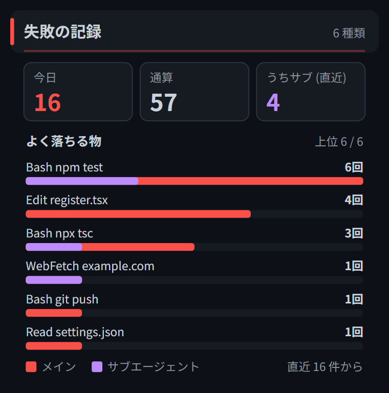</td>
</tr>
<tr>
<td align="center" valign="top"><b>daily-quest</b><br>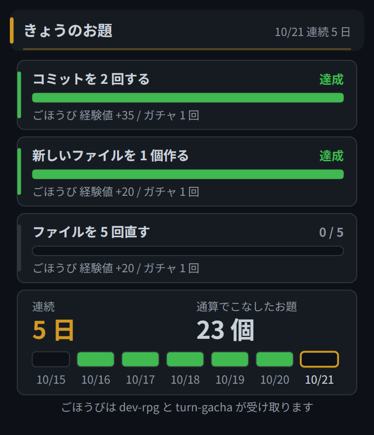</td>
<td align="center" valign="top"><b>trophy-shelf</b><br>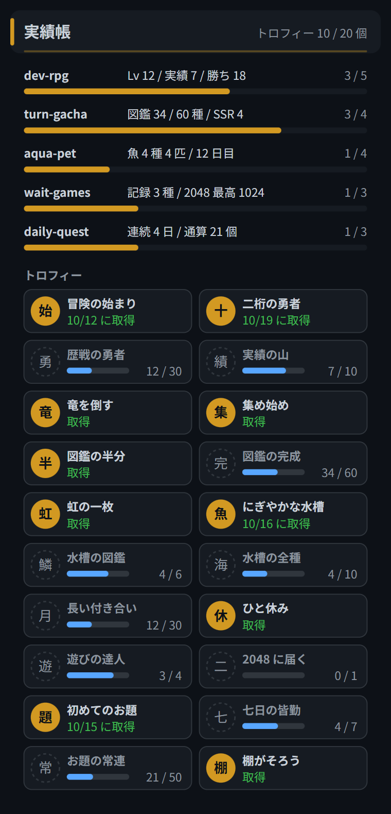</td>
<td align="center" valign="top"><b>mod-check</b><br>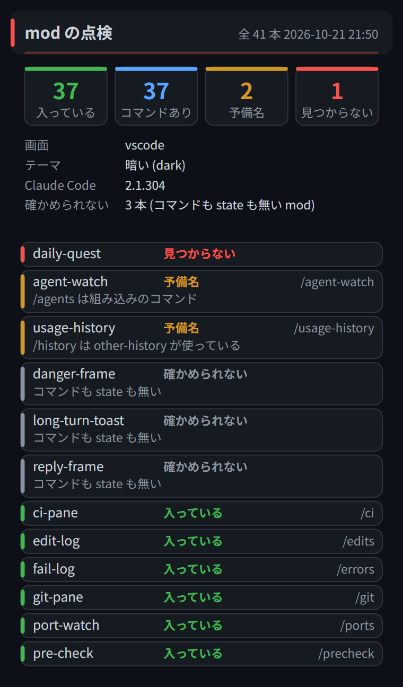</td>
</tr>
<tr>
<td align="center" valign="top"><b>compact-cue</b><br>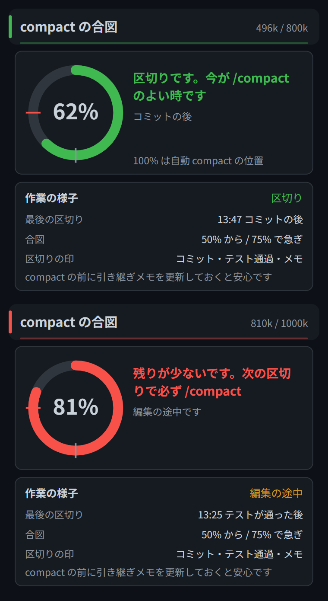</td>
<td align="center" valign="top"><b>ship-guard</b><br>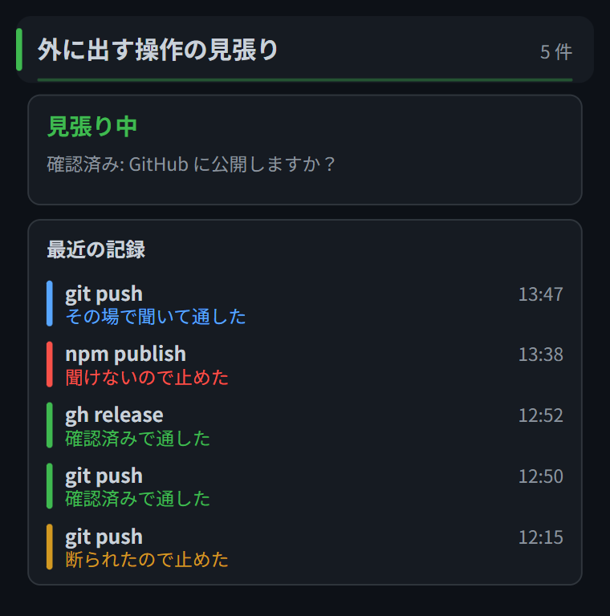</td>
<td align="center" valign="top"><b>rule-watch</b><br>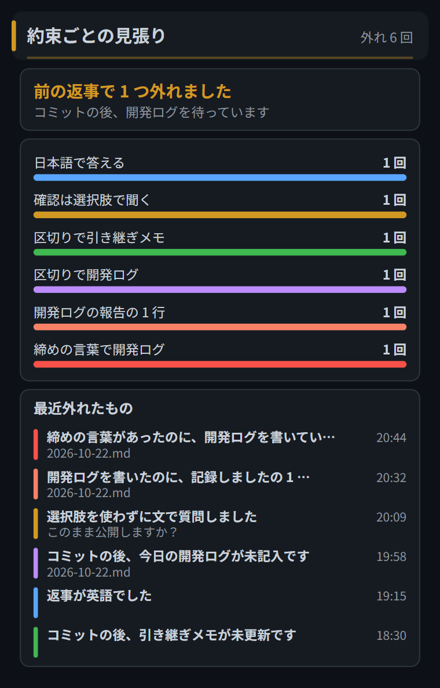</td>
</tr>
<tr>
<td align="center" valign="top"><b>enc-guard</b><br>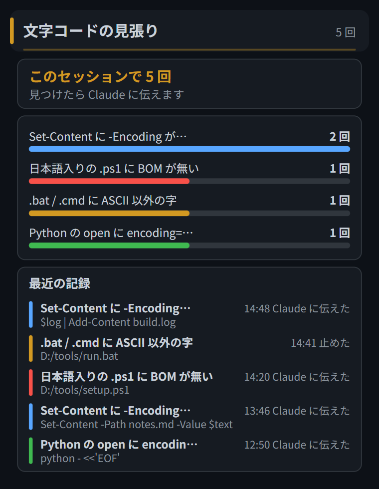</td>
<td align="center" valign="top"><b>release-draft</b><br>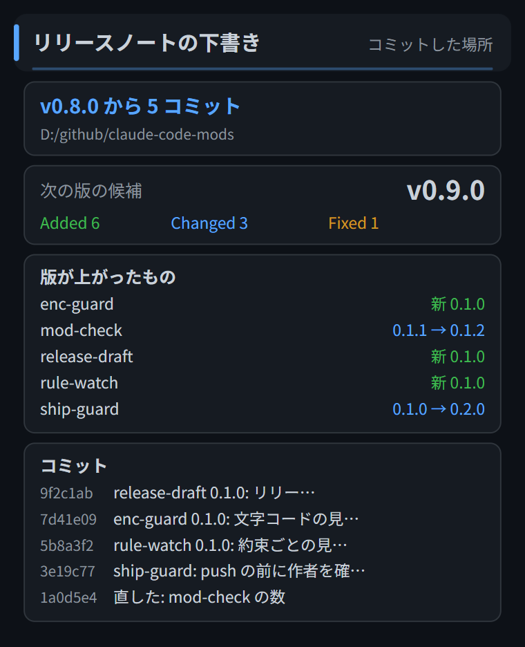</td>
<td align="center" valign="top"><b>run-guard</b><br>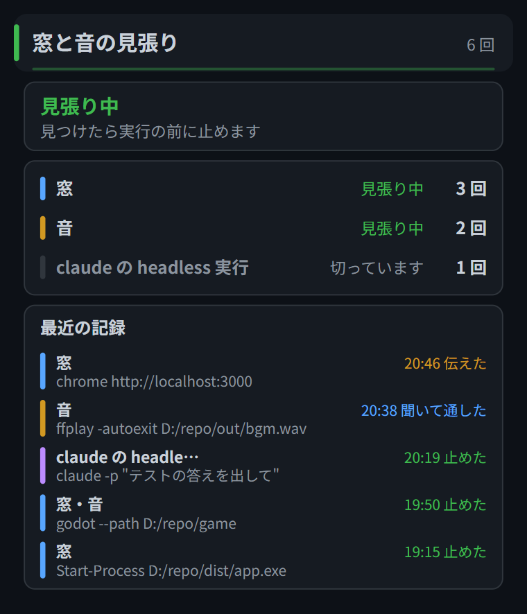</td>
</tr>
<tr>
<td align="center" valign="top"><b>week-card</b><br>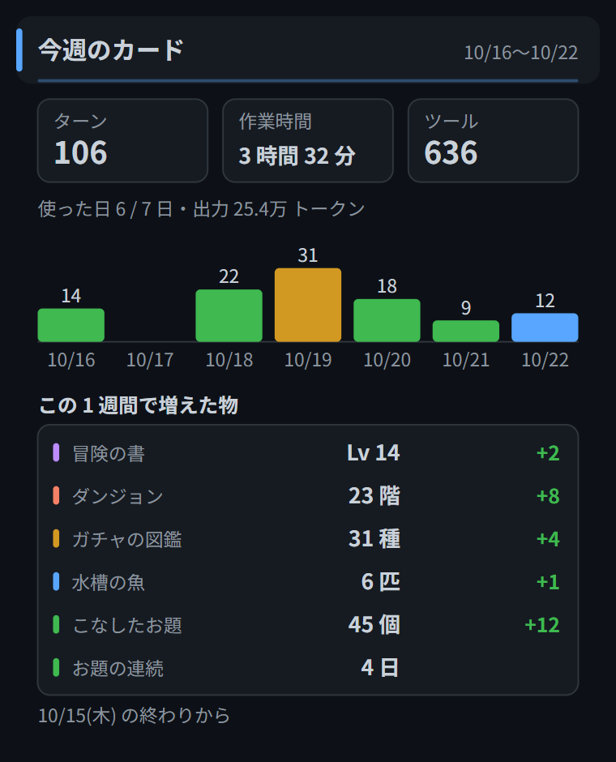</td>
</tr>
</table>

### Animations

The pane pictures animate once when opened (numbers count up, bars grow, the fortune unfolds). Regenerate them with `node tools/gif.mts <mod>`.

<table>
<tr>
<td align="center" valign="top"><b>mod-hub</b><br>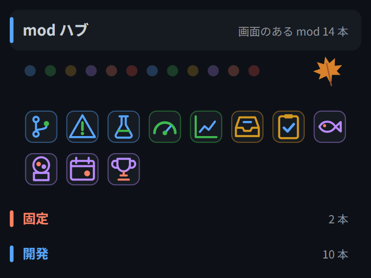</td>
<td align="center" valign="top"><b>cc-dash</b><br>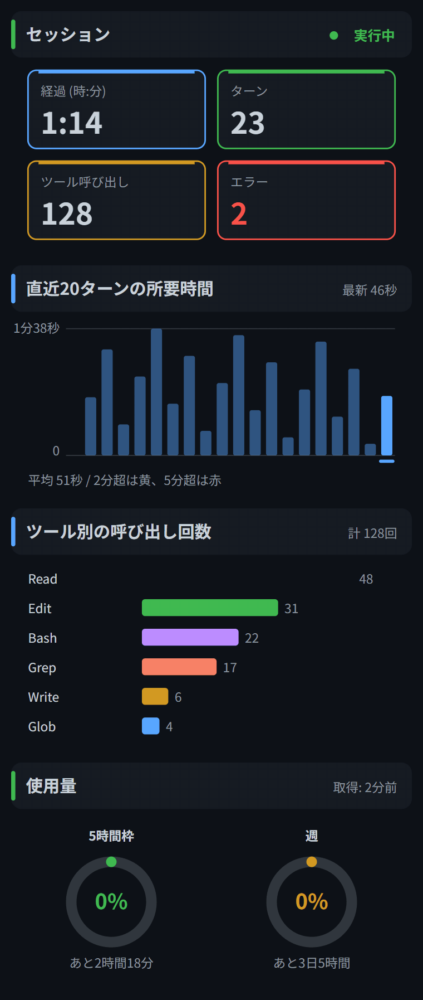</td>
</tr>
<tr>
<td align="center" valign="top"><b>usage-history</b><br>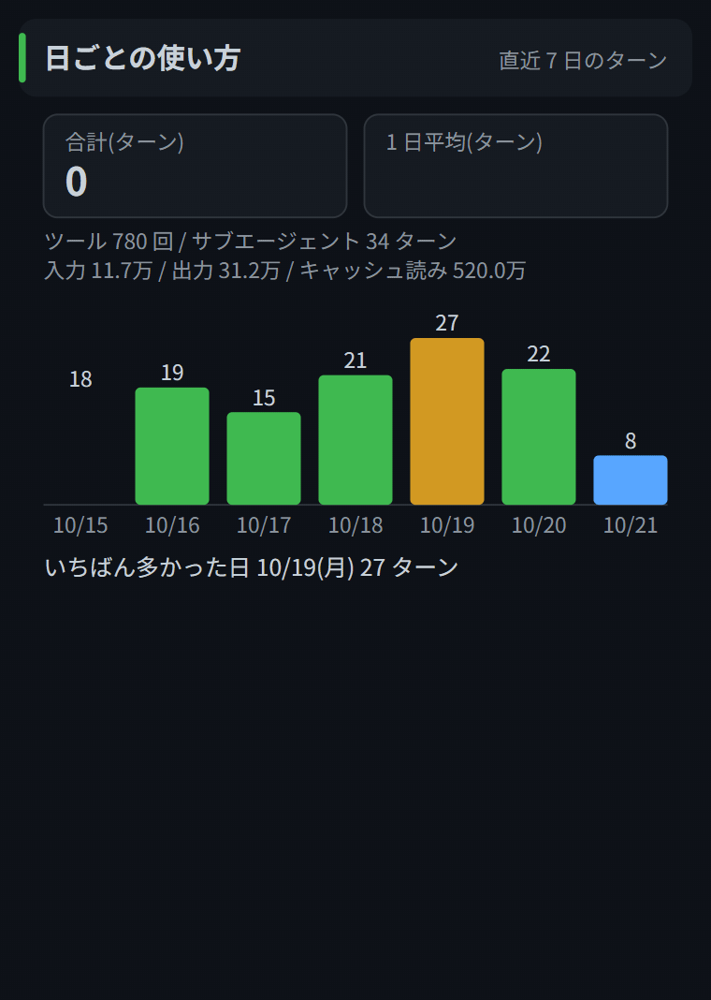</td>
<td align="center" valign="top"><b>code-omikuji</b><br>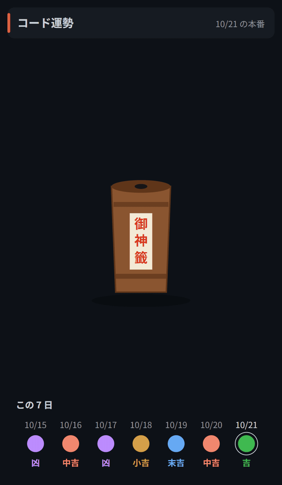</td>
</tr>
</table>

### Light theme

If you set Claude Code's theme to a light one (one starting with "light") in `/config`, the SVGs are drawn in light colors too (mods can't read VS Code's color theme, so they follow Claude Code's theme).

<table>
<tr>
<td align="center" valign="top"><b>mod-hub</b><br></td>
<td align="center" valign="top"><b>git-pane</b><br></td>
<td align="center" valign="top"><b>usage-history</b><br></td>
</tr>
</table>

## Requirements

- Claude Code 2.1.300 or later (a version that can load function-hook mods)
- To draw in VS Code you need the VS Code extension 2.1.300 or later. Extensions up to 2.1.288 can't draw mods
- They also work in the terminal and the desktop app. In the terminal, a text-only view is shown instead of the SVG

## Installation

Install only the mods you want. If you only want the adventure log (dev-rpg) and the gacha (turn-gacha), you can also install them from the standalone [claude-code-dev-rpg](https://github.com/takosasi-dev/claude-code-dev-rpg) (the contents are the same, so install from only one of the two). At the prompt of Claude Code in a terminal:

```
/plugin install cc-dash --marketplace takosasi-dev/claude-code-mods
```

Press `y` to add the marketplace, choose a scope, and it's installed. From a shell:

```sh
claude plugin install cc-dash --marketplace takosasi-dev/claude-code-mods
```

In the desktop app, open + next to the prompt, then Plugins, enter `takosasi-dev/claude-code-mods` under Add marketplace, and pick the mods under Add plugin.

mod-hub lists only the mods loaded after mod-hub, so install mod-hub first. Categories and icons are defined only for the mods in this repository; other mods go under "Other". toast-inbox and mod-check also watch the mods loaded after them, so we recommend installing them right after mod-hub.

If a command name clashes with another plugin or a built-in, the command becomes the mod's name, such as `/edit-log`, `/todo-board`, `/test-runner`, `/prompt-book`, `/live-commentary`, `/turn-gacha`, `/dev-rpg`, `/code-omikuji`, `/gitpane`, `/token-meter`, `/mod-hub`, `/canvas-pane`, `/rule-switch`, `/wait-games`, `/spec-board`, `/ci-pane`, `/port-watch`, `/pre-check`, `/face-band`, `/done-chime`, `/turn-haiku`, `/session-timeline`, `/file-map`, `/toast-inbox`, `/usage-history`, `/fail-log`, `/compact-cue`, `/ship-guard`, `/rule-watch`, `/enc-guard`, `/release-draft`, `/daily-quest`, `/trophy-shelf`, `/modcheck`, `/run-guard`, or `/week-card`.

### Install several at once

`claude plugin install` takes one plugin per call. To install several, paste one of the blocks below into your shell as is (bash, zsh, or PowerShell all work). The first line adds the marketplace and the rest reuse it. The scope defaults to user (all projects); add `-s project` to install for the current project only. Install mod-hub, toast-inbox and mod-check first, then open the categories you want and paste them.

**First** (mod-hub, toast-inbox, mod-check)

```sh
claude plugin install mod-hub --marketplace takosasi-dev/claude-code-mods
claude plugin install toast-inbox --marketplace takosasi-dev/claude-code-mods
claude plugin install mod-check --marketplace takosasi-dev/claude-code-mods
```

<details><summary>Dev (15 mods): project-board, git-pane, edit-log, todo-board, test-runner, spec-board, ci-pane, port-watch, pre-check, fail-log, ship-guard, rule-watch, enc-guard, release-draft, run-guard</summary>

```sh
claude plugin install project-board --marketplace takosasi-dev/claude-code-mods
claude plugin install git-pane --marketplace takosasi-dev/claude-code-mods
claude plugin install edit-log --marketplace takosasi-dev/claude-code-mods
claude plugin install todo-board --marketplace takosasi-dev/claude-code-mods
claude plugin install test-runner --marketplace takosasi-dev/claude-code-mods
claude plugin install spec-board --marketplace takosasi-dev/claude-code-mods
claude plugin install ci-pane --marketplace takosasi-dev/claude-code-mods
claude plugin install port-watch --marketplace takosasi-dev/claude-code-mods
claude plugin install pre-check --marketplace takosasi-dev/claude-code-mods
claude plugin install fail-log --marketplace takosasi-dev/claude-code-mods
claude plugin install ship-guard --marketplace takosasi-dev/claude-code-mods
claude plugin install rule-watch --marketplace takosasi-dev/claude-code-mods
claude plugin install enc-guard --marketplace takosasi-dev/claude-code-mods
claude plugin install release-draft --marketplace takosasi-dev/claude-code-mods
claude plugin install run-guard --marketplace takosasi-dev/claude-code-mods
```

</details>

<details><summary>Status (11 mods): cc-dash, work-bar, token-meter, session-recap, agent-watch, session-timeline, file-map, usage-history, compact-cue, usage-pane, devlog-pane</summary>

```sh
claude plugin install cc-dash --marketplace takosasi-dev/claude-code-mods
claude plugin install work-bar --marketplace takosasi-dev/claude-code-mods
claude plugin install token-meter --marketplace takosasi-dev/claude-code-mods
claude plugin install session-recap --marketplace takosasi-dev/claude-code-mods
claude plugin install agent-watch --marketplace takosasi-dev/claude-code-mods
claude plugin install session-timeline --marketplace takosasi-dev/claude-code-mods
claude plugin install file-map --marketplace takosasi-dev/claude-code-mods
claude plugin install usage-history --marketplace takosasi-dev/claude-code-mods
claude plugin install compact-cue --marketplace takosasi-dev/claude-code-mods
claude plugin install usage-pane --marketplace takosasi-dev/claude-code-mods
claude plugin install devlog-pane --marketplace takosasi-dev/claude-code-mods
```

</details>

<details><summary>Tools (5 mods): focus-timer, prompt-book, canvas-pane, rule-switch, done-chime</summary>

```sh
claude plugin install focus-timer --marketplace takosasi-dev/claude-code-mods
claude plugin install prompt-book --marketplace takosasi-dev/claude-code-mods
claude plugin install canvas-pane --marketplace takosasi-dev/claude-code-mods
claude plugin install rule-switch --marketplace takosasi-dev/claude-code-mods
claude plugin install done-chime --marketplace takosasi-dev/claude-code-mods
```

</details>

<details><summary>Fun (11 mods): aqua-pet, live-commentary, turn-gacha, dev-rpg, code-omikuji, wait-games, face-band, turn-haiku, daily-quest, trophy-shelf, week-card</summary>

```sh
claude plugin install aqua-pet --marketplace takosasi-dev/claude-code-mods
claude plugin install live-commentary --marketplace takosasi-dev/claude-code-mods
claude plugin install turn-gacha --marketplace takosasi-dev/claude-code-mods
claude plugin install dev-rpg --marketplace takosasi-dev/claude-code-mods
claude plugin install code-omikuji --marketplace takosasi-dev/claude-code-mods
claude plugin install wait-games --marketplace takosasi-dev/claude-code-mods
claude plugin install face-band --marketplace takosasi-dev/claude-code-mods
claude plugin install turn-haiku --marketplace takosasi-dev/claude-code-mods
claude plugin install daily-quest --marketplace takosasi-dev/claude-code-mods
claude plugin install trophy-shelf --marketplace takosasi-dev/claude-code-mods
claude plugin install week-card --marketplace takosasi-dev/claude-code-mods
```

</details>

<details><summary>Always on (3 mods): reply-frame, danger-frame, long-turn-toast</summary>

```sh
claude plugin install reply-frame --marketplace takosasi-dev/claude-code-mods
claude plugin install danger-frame --marketplace takosasi-dev/claude-code-mods
claude plugin install long-turn-toast --marketplace takosasi-dev/claude-code-mods
```

</details>

All 48 at once (bash / zsh):

```sh
for m in mod-hub toast-inbox mod-check cc-dash work-bar aqua-pet project-board git-pane token-meter focus-timer session-recap edit-log todo-board test-runner prompt-book live-commentary turn-gacha dev-rpg code-omikuji agent-watch canvas-pane rule-switch wait-games spec-board ci-pane port-watch pre-check face-band done-chime turn-haiku session-timeline file-map usage-history compact-cue fail-log ship-guard rule-watch enc-guard release-draft daily-quest trophy-shelf reply-frame danger-frame long-turn-toast usage-pane devlog-pane run-guard week-card; do claude plugin install "$m" --marketplace takosasi-dev/claude-code-mods; done
```

PowerShell:

```powershell
foreach ($m in 'mod-hub','toast-inbox','mod-check','cc-dash','work-bar','aqua-pet','project-board','git-pane','token-meter','focus-timer','session-recap','edit-log','todo-board','test-runner','prompt-book','live-commentary','turn-gacha','dev-rpg','code-omikuji','agent-watch','canvas-pane','rule-switch','wait-games','spec-board','ci-pane','port-watch','pre-check','face-band','done-chime','turn-haiku','session-timeline','file-map','usage-history','compact-cue','fail-log','ship-guard','rule-watch','enc-guard','release-draft','daily-quest','trophy-shelf','reply-frame','danger-frame','long-turn-toast','usage-pane','devlog-pane','run-guard','week-card') { claude plugin install $m --marketplace takosasi-dev/claude-code-mods }
```

Regenerate this list with `node tools/plugin_dirs.mts --readme --en` (without `--en` for the Japanese README).

### Load from a cloned folder

You can also clone the repository and load the mods from that folder.

- Add the folder as a marketplace: in the lines above, replace `takosasi-dev/claude-code-mods` with the path of your clone (e.g. `D:\work\claude-code-mods`). The mods are read straight from that folder, so after a `git pull`, `/reload-plugins` picks up the new version
- Load them with `CLAUDE_CODE_PLUGIN_DIRS`: nothing is installed; each session reads the folders when it starts. Run `node tools/plugin_dirs.mts` in your clone to print the value (or `node tools/plugin_dirs.mts D:\work\claude-code-mods` to point at another location). It is one line with every mod folder, mod-hub, toast-inbox and mod-check first, joined by `;` on Windows and `:` elsewhere. Put it in an environment variable, or in `CLAUDE_CODE_PLUGIN_DIRS` under `env` in `~/.claude/settings.json` (the tool never edits settings.json). Remove the mods you don't want from the line

```
D:\work\claude-code-mods\mods\mod-hub;D:\work\claude-code-mods\mods\toast-inbox;D:\work\claude-code-mods\mods\cc-dash;...
```

## Things to know

- rule-switch's rules also go into subagents' system prompts. In environments where an organization manages Claude Code, system prompt hooks from user-installed plugins don't run
- Switching rule-switch rebuilds the prompt cache
- canvas-pane's tool refuses raw SVG that contains scripts, event attributes, or external references (the pane draws it as an image, and scripts don't run)
- turn-haiku calls the Haiku model once for each turn that ended with an answer (when it used a tool or took 20 seconds or more), which uses tokens. You can stop it with "auto compose" in `/haiku`
- port-watch's "stop" kills the process together with its children (`taskkill /T /F` on Windows). MCP servers running on node also look like development runtimes, so check the name and port before stopping. Not yet tested on real macOS / Linux (`lsof`)
- pre-check's secret detection is only a hint. Finding nothing doesn't mean it's safe
- done-chime plays sounds with PowerShell's SoundPlayer on Windows. Elsewhere it uses Claude Code's sound playback, which may not sound in a Linux terminal
- spec-board's list may hit rate limits because SpecStatus uses the GitHub API. It reloads every 5 minutes
- ci-pane and the mods that read git stop working in folders owned by another user (on another drive, for example). Add `git config --global --add safe.directory <folder>`
- aqua-pet redraws its background every 15 minutes. When redrawn, the swimming and bubble animations start over
- aqua-pet 0.2 records are carried over by creating as many fish as you had when you open it. If 0.2 and 0.3 sessions are open at the same time, the arrival dates of the fish may be recreated
- dev-rpg equipment works only when installed together with turn-gacha 0.2.0 or later. Cards removed from the gacha book are treated as unequipped, but the record is kept
- toast-inbox only picks up toasts when other mods call `$.ui.toast` / `$.ui.status`. "Clear" also erases the records of other sessions
- usage-history counts from the turns after you install it. Dates, weekdays, and times are in Japan time
- file-map doesn't count failed calls. Grep and Glob are counted only when given a path
- Even in the light theme, the aquarium, the haiku card, the fortune paper, the commentary stadium, and the RPG windows keep their own picture colors
- After updating a mod's version, reopen your other open sessions too. From 0.7.0, records are written keeping fields the mod doesn't know, so newer records are no longer erased; but a session still running a 0.6-or-earlier mod writes back without the fields added in newer versions (fish species, equipment, SP allocation, and so on)
- fail-log's record is shared by all sessions open at the same time. "Today" is the date in Japan time, counted from the 200 entries kept
- todo-board reads with `git grep` inside git (it doesn't read .gitignored files). Outside git it walks the working folder (stopping at 2000 files, 5000 items, or 8 seconds, and skipping files over 1 MiB, folders starting with `.`, node_modules, dist, and so on); in that case it doesn't reload on its own when files change, so press "reload"
- daily-quest tasks are decided by the date in Japan time alone. Only main turns are counted, and "test" is judged by the shape of the command name (`npm test`, `pytest`, and so on). dev-rpg and turn-gacha each receive the reward once, at the end of a turn
- trophy-shelf only reads other mods' records. Shelves of mods that aren't installed say "not installed". A trophy once earned stays even if you remove that mod
- cc-dash's "My layout" is saved in the record, so it's shared by all sessions
- mod-check can show versions and "refused to load" only for mods loaded after it. "No state yet" does not mean broken (some mods write their values only when opened). reply-frame, danger-frame, and long-turn-toast have neither a command nor state, so they show as "can't check"
- compact-cue reads the usage after each Claude reply and counts the point where auto-compact runs as 100% (or the model's window when that point is unknown). It shows "─" before the first reply, and the post-compact figure right after a compact. Break points are recognized by the shape of the command (`git commit`, `npm test`, `pytest`, ...) and by writes under `memoDir`
- ship-guard watches only the Bash and PowerShell tools. It cannot recognize git called through a quoted path (`& "C:\...\git.exe" push`) or a push inside a script. A confirmation counts only when the question or the answer is about publishing (push, publish, release, ...) and the answer is not a refusal; it lasts for that turn and the next. Where it cannot ask (such as `claude -p`), it blocks
- ship-guard's pre-push check reads the commits that no remote has yet (up to 200) with `git log -p`, in the folder named by the `cd` or `git -C` before the push. It ignores noreply and example.com addresses and anything in `allowedEmails`, and ignores `<drive>:\Users\<name>` when the name is one letter or a placeholder (user, runner, ...)
- rule-watch reads only the last text of each main reply (not text written between tool calls). English is judged from the prose letters, without code, paths, or URLs. The note check works only with `memoDir` set, and counts a Write / Edit under that folder or a shell command that names it as writing the note
- enc-guard checks a .ps1 BOM before writing for Write and by reading the file after writing for Edit. It does not watch Out-File or `>` (in this PowerShell setup they write UTF-8 with a BOM)
- release-draft reads the folder where Claude last ran `git commit` (the `cd` target), or the session folder before any commit. Versions compare the tag with the current working tree, so uncommitted bumps show too
- test-runner picks up commands shaped like tests (`npm test`, `pytest`, `cargo test`, `node --test`, `claude plugin test`, ...) or starting like your `testCommand`. Background runs (`run_in_background`) are not counted
- From 0.10.0, mods that write records stop writing and ask you (toast) to reopen VS Code when they notice a newer version was installed while the session still runs the old one. mod-check flags changed sibling versions in the band (only when loading from a cloned folder)
- "控えから戻す" overwrites the current record with the chosen day. Backups start from the day you set `backupDir`
- run-guard only reads Bash and PowerShell command strings. It cannot see apps started inside scripts or claude.exe spawned from node
- rule-watch counts a dev log as written by Write / Edit and by paths in shell commands. Writes through MCP tools are not counted
- In the dev-rpg dungeon you take one step per turn and fight the floor's enemy automatically after 8 steps. If you fall, you keep half of the bag's experience
- week-card starts its daily snapshots on the day you install it, so the growth numbers appear from the next day. It computes the dev-rpg level with a copy of dev-rpg's formula

## Mods that need settings

These mods show "not set" until you set the file or folder they read. Set it in `/config`, or write it under `pluginConfigs` in `~/.claude/settings.json`.

| mod | Key | Value |
|---|---|---|
| cc-dash / usage-pane | `usageFile` | Absolute path to the usage JSON (format below) |
| project-board | `memoDir` | Folder of handoff notes (*.md) |
| project-board | `vaultRoot` / `vaultName` | Root and name of an Obsidian vault (adds "Open in Obsidian") |
| devlog-pane | `logDir` | Folder of YYYY-MM-DD.md files (dates in Japan time) |
| test-runner | `testCommand` | Test command (e.g. `npm test`; split on spaces, not run through a shell) |
| test-runner | `timeoutSeconds` | Time limit in seconds (default 300) |
| pre-check | `testCommand` / `timeoutSeconds` | Same as test-runner. If empty, the test item is skipped |
| compact-cue | `notifyPercent` / `urgentPercent` | Usage (%) at which the cue starts and becomes urgent (default 50 / 75) |
| compact-cue | `memoDir` | Folder of handoff notes; writing there also counts as a break point (works without it) |
| ship-guard | `checkBeforePush` | Check the contents before push (default on) |
| ship-guard | `allowedEmails` / `privateWords` | Emails not to flag (comma separated, `@example.org` for a whole domain) and words to flag in added lines or author names |
| rule-watch | `checkEnglish` / `checkQuestion` | Watch for English replies and text questions (default on) |
| rule-watch | `memoDir` / `memoGraceTurns` | Folder of handoff notes (empty skips the note check) and how many turns to wait for the memo and dev log after a commit (default 0) |
| rule-watch | `logDir` | Dev log folder. Watches today's `YYYY-MM-DD.md` (JST) in it for a missing log after a commit, a missing "logged" line, and a missing log when you close the day (empty turns it off) |
| run-guard | `mode` / `windowApps` | What to do on a hit: `止める` (default; block and return the fix), `聞く` (ask), or `伝えるだけ` (just tell), and exe names always treated as windowed (comma-separated, empty by default) |
| aqua-pet, dev-rpg, turn-gacha, daily-quest, wait-games, usage-history | `backupDir` | Folder for daily backups under `<backupDir>/<mod>/` (7 days kept). Restore with "控えから戻す" in the pane (empty: no backups) |
| enc-guard | `mode` / `checkPython` | Whether to tell ("知らせる") or block ("止める") when found (default tell), and whether to check Python's open (default on, Windows only) |
| spec-board | `pythonPath` | Absolute path to python (`python` or `py` also works if on PATH) |
| spec-board | `specstatusScript` | Absolute path to SpecStatus's `specstatus.py` |

```json
"pluginConfigs": {
  "project-board@claude-code-mods": {
    "options": { "memoDir": "D:\\notes\\handoff" }
  }
}
```

The key depends on how you installed the mod: `<mod>@claude-code-mods` when installed from the marketplace, and `<mod>` when loading the folder with `--plugin-dir` or `CLAUDE_CODE_PLUGIN_DIRS`. Write absolute paths (a relative path is treated as not set).

The usage JSON is meant to be written by another tool. Its format is below (the `model*` fields are optional).

```json
{ "sessionPct": 9, "weeklyPct": 2, "sessionResetAt": "2026-10-20T03:00:00+00:00",
  "weeklyResetAt": "2026-10-26T19:00:00+00:00", "modelName": "Opus", "modelPct": 0,
  "modelResetAt": "2026-10-26T19:00:00+00:00", "fetchedAt": 1792462154448 }
```

## Making your own

[docs/mod-guide.md](docs/mod-guide.md) (in Japanese) collects the rules for getting rich visuals in VS Code too: the components VS Code supports and how Svg behaves (animations run, but hover and clicks don't), the pitfalls of the band above the prompt, how to keep state, the shared look and the light theme, how to write tests, and more.

The colors, headers, and motion shared by all mods live in a single `shared/style.ts`, and each mod's `hooks/style.ts` is a copy of it. After editing, copy it with `node tools/copy_shared.mts`.

dev-rpg and turn-gacha are also copied to a standalone repository. At release, `node tools/export_standalone.mts` copies them to claude-code-dev-rpg in the neighboring folder, and `--check` confirms they haven't drifted.

You can check each mod in its folder. To check validate, tests, and types for all mods at once, use `node tools/check_all.mts`; to measure how heavy the mods are, use `node tools/perf.mts` (results in [docs/dev/perf.md](docs/dev/perf.md), in Japanese).

```sh
claude plugin validate mods/cc-dash
claude plugin test mods/cc-dash
```

## Status

- Tests pass for all mods (`claude plugin test`)
- On the real screen of the VS Code extension 2.1.300, we have confirmed panes, buttons, toasts, SVG animations, that the screens of the mods up to 0.4.0 open, and that work-bar's band appears
- The mods added in 0.5.0 (spec-board, ci-pane, port-watch, pre-check, face-band, done-chime, turn-haiku) are tested only so far; checking them on the real screen is still to come
- The mods added in 0.6.0 (session-timeline, file-map, toast-inbox, usage-history), the shared look, and the light theme are likewise confirmed only by tests and pictures taken with headless Chrome; checking them on the real screen is still to come
- The mods added in 0.7.0 (fail-log, daily-quest, trophy-shelf, mod-check), the time-of-day and seasonal looks, and reordering in /dash are also confirmed only by tests and pictures taken with headless Chrome
- The mods added in 0.8.0 (compact-cue, ship-guard) and test-runner's watching are also confirmed only by tests and pictures taken with headless Chrome
- The mods added in 0.10.0 (run-guard, week-card), the dungeon, aquarium ornaments, backups and the checklist are also confirmed only by tests and headless Chrome pictures. The /mod-check Checklist tab lists what to look at on screen
- The mods added in 0.9.0 (rule-watch, enc-guard, release-draft) and ship-guard's pre-push check are also confirmed only by tests and pictures taken with headless Chrome
- The function-hook API is still in early access and may change between Claude Code versions

## License

MIT
